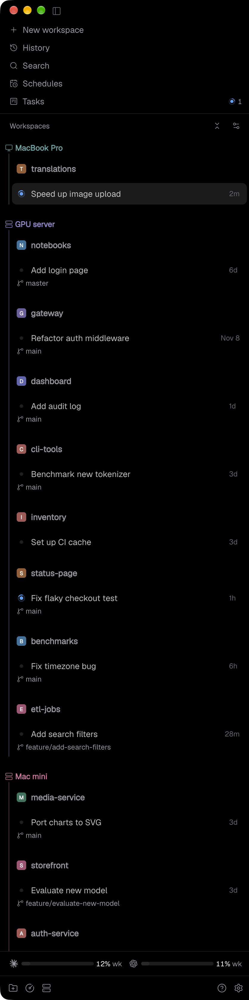
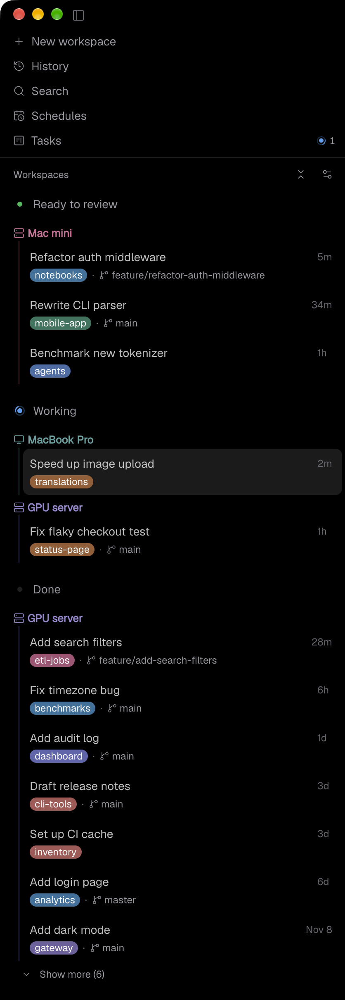

# Lucid sidebar for Paseo

[中文](README.zh-CN.md)

A [Paseo](https://paseo.sh) sidebar view for people who run Paseo on more than one host. It keeps the look and sorting of the built-in workspace list, and groups each host's projects and workspaces together under headings you can fold.

- Host headings with a guide line in the host's color, this device's host first
- A project on several hosts appears under each of them, with only that host's workspaces; projects with no workspaces stay hidden
- Project tags on every row, in the same color as the project tile
- Fold or unfold every host, project and status group with one button
- Everything the built-in list shows: pinned workspaces, project or status grouping, status indicators, diff stats, pull requests, checks, services and labels, with the same display menu

<p>
  
  
</p>

See [OVERVIEW.md](OVERVIEW.md) for the full description, the data the plugin reads, and its limits.

## Requirements

- Paseo 0.16.1 or later, on the app and on the daemon you install the plugin on
- Plugins enabled on that daemon (Settings > Plugins > Enable plugins)

## Install

Install from the [Paseo plugin registry](https://paseo.sh/plugins):

```bash
paseo plugin add yiju-zhao/lucid-sidebar
```

Or from npm or GitHub, pinned to a release:

```bash
paseo plugin add npm:paseo-lucid-sidebar@0.3.0
paseo plugin add git:yiju-zhao/paseo-lucid-sidebar --ref v0.3.0
```

Then choose **Lucid sidebar** under Settings > Sidebar > Sidebar view. Paseo does not switch views on install, and choosing the default view again restores the built-in list.

Update or remove it later:

```bash
paseo plugin update paseo-lucid-sidebar
paseo plugin remove paseo-lucid-sidebar
```

The plugin only has client code, so installing it on one daemon covers every host the app is connected to.

## Development

```bash
git clone https://github.com/yiju-zhao/paseo-lucid-sidebar.git
cd paseo-lucid-sidebar
npm install
npm run typecheck   # plugin code, then the tests
npm test            # list model and save queue tests

# Run your checkout in Paseo, then reload after each change
paseo plugin install "$(pwd)"
paseo plugin reload paseo-lucid-sidebar
paseo plugin logs paseo-lucid-sidebar
```

Paseo compiles the TypeScript itself; there is no build step. Client code must use React Native primitives only, so it runs on desktop, web and mobile.

### Layout

| Path | Role |
| --- | --- |
| `index.client.tsx` | Registers the sidebar view |
| `shared/preferences.ts` | Display preferences: schema, defaults and migrations |
| `client/sidebar.tsx` | The view: queries, then the list model, then renderers |
| `client/queries.ts` | Turns Paseo's query hooks into plain data |
| `client/layout.ts` | The list model: sections, host groups, project blocks, show more and folds. Pure and tested |
| `client/sections.tsx` | Draws the list model: headers, host groups, project blocks, status groups |
| `client/workspace-row.tsx` | A workspace row |
| `client/row-items.tsx` | The row's second line; one entry per item drives the line, the Show menu and data subscriptions |
| `client/row-menu.tsx`, `client/display-menu.tsx` | The row menu and the display menu |
| `client/runtime.tsx` | Pull request, checks, service and project data, one watcher per host |
| `client/preferences.ts`, `client/save-queue.ts` | Optimistic, revision-checked saves of the preferences |
| `client/keys.ts` | Every stored collapse key format |
| `client/model.ts`, `client/palette.ts` | Sorting and filtering rules; colors |
| `tests/` | `node:test` suites run with tsx |

To add an item to the row's second line, add one entry to `ROW_ITEMS` in `client/row-items.tsx`, and a switch to `rowItems` in `shared/preferences.ts` if it needs one. To change the defaults new users see, edit the schema in `shared/preferences.ts`; changing a stored format needs a settings migration there.

## License

MIT. See [LICENSE](LICENSE).
