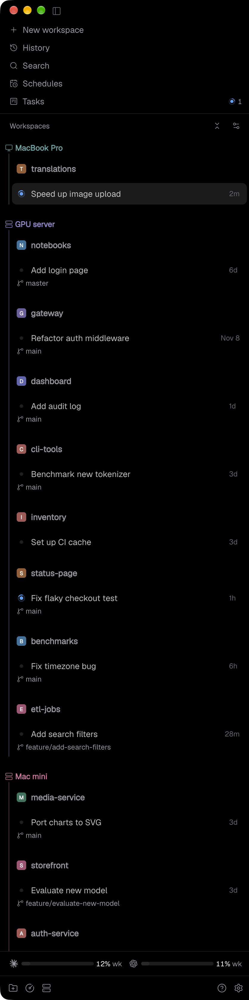
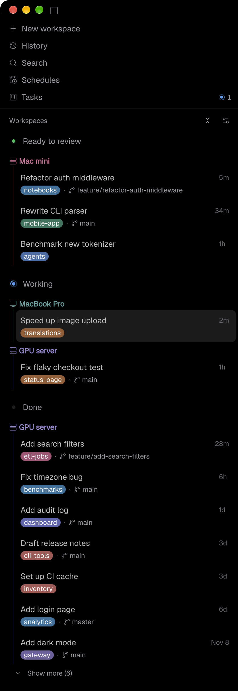

# Lucid sidebar for Paseo

[English](README.md)

为在多台 host 上使用 [Paseo](https://paseo.sh) 的人设计的侧边栏视图。它保留内置工作区列表的外观和排序，并把每台 host 的项目和工作区放在一起，归在可折叠的标题下。

- host 标题带有该 host 颜色的引导线，本设备的 host 排在最前
- 同一项目在多台 host 上时，会分别出现在每台 host 下，只包含该 host 的工作区；没有工作区的项目自动隐藏
- 每行都有项目标签，颜色与项目图标相同
- 一个按钮即可折叠或展开所有 host、项目和状态组
- 内置列表的全部内容：置顶工作区、按项目或状态分组、状态指示、改动行数、pull request、检查、服务和标签，以及相同的显示菜单

<p>
  
  
</p>

完整介绍、插件读取的数据和已知限制见 [OVERVIEW.zh-CN.md](OVERVIEW.zh-CN.md)。

## 环境要求

- app 和安装插件的 daemon 都需要 Paseo 0.16.1 或更高版本
- 该 daemon 已启用插件（设置 > 插件 > 启用插件）

## 安装

从 [Paseo 插件市场](https://paseo.sh/plugins) 安装：

```bash
paseo plugin add yiju-zhao/lucid-sidebar
```

或从 npm 或 GitHub 安装，并固定到某个发布版本：

```bash
paseo plugin add npm:paseo-lucid-sidebar@0.3.1
paseo plugin add git:yiju-zhao/paseo-lucid-sidebar --ref v0.3.1
```

然后在 设置 > 侧边栏 > 侧边栏视图 中选择 **Lucid sidebar**。安装后 Paseo 不会自动切换视图，重新选择默认视图即可恢复内置列表。

之后更新或移除：

```bash
paseo plugin update paseo-lucid-sidebar
paseo plugin remove paseo-lucid-sidebar
```

插件只有客户端代码，所以安装在一个 daemon 上就能覆盖 app 连接的所有 host。

## 开发

```bash
git clone https://github.com/yiju-zhao/paseo-lucid-sidebar.git
cd paseo-lucid-sidebar
npm install
npm run typecheck   # 先检查插件代码，再检查测试
npm test            # 列表模型和保存队列的测试

# 在 Paseo 中运行本地代码，每次修改后 reload
paseo plugin install "$(pwd)"
paseo plugin reload paseo-lucid-sidebar
paseo plugin logs paseo-lucid-sidebar
```

Paseo 会自己编译 TypeScript，不需要构建步骤。客户端代码只能使用 React Native 基础组件，这样才能在桌面、网页和手机上运行。

### 代码结构

| 路径 | 作用 |
| --- | --- |
| `index.client.tsx` | 注册侧边栏视图 |
| `shared/preferences.ts` | 显示偏好：结构、默认值和迁移 |
| `client/sidebar.tsx` | 视图入口：查询数据，生成列表模型，再渲染 |
| `client/queries.ts` | 把 Paseo 的查询 hook 转成普通数据 |
| `client/layout.ts` | 列表模型：分区、host 分组、项目块、显示更多和折叠。纯函数，有测试 |
| `client/sections.tsx` | 绘制列表模型：标题、host 分组、项目块、状态组 |
| `client/workspace-row.tsx` | 工作区行 |
| `client/row-items.tsx` | 行的第二行；每个显示项一个条目，同时决定这一行、Show 菜单和数据订阅 |
| `client/row-menu.tsx`、`client/display-menu.tsx` | 行菜单和显示菜单 |
| `client/runtime.tsx` | pull request、检查、服务和项目数据，每台 host 一个监听 |
| `client/preferences.ts`、`client/save-queue.ts` | 偏好的乐观更新和带版本校验的保存 |
| `client/keys.ts` | 所有折叠状态的存储格式 |
| `client/model.ts`、`client/palette.ts` | 排序和筛选规则；颜色 |
| `tests/` | 用 tsx 运行的 `node:test` 测试 |

要给行的第二行加一个显示项，在 `client/row-items.tsx` 的 `ROW_ITEMS` 里加一个条目；如果需要开关，再在 `shared/preferences.ts` 的 `rowItems` 里加一项。要修改新用户看到的默认值，编辑 `shared/preferences.ts` 里的结构；如果改动了已存储数据的格式，需要在那里加一个设置迁移。

## 许可证

MIT，见 [LICENSE](LICENSE)。
